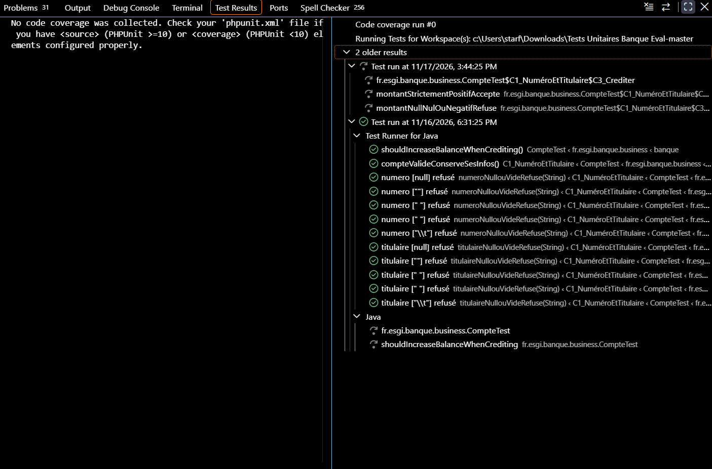

# Rendu - Tests unitaires et TDD

Nom : ZOGO OBAME
Prénom : Nicolas Erwan
Campus : ESGI Grenoble , IW

Dépôt : https://github.com/Nico-rgb-jpg/Tests_Unitaires_Banque_Eval

## Partie A - Défauts trouvés

J'ai fait une classe de test par classe (CompteTest et CalculFraisTest), avec un @Nested par règle.
Pour chaque défaut, j'ai d'abord commité le test qui échoue (test:), puis la correction (fix:).

1. C3 - crediter acceptait un montant de 0.
   Le code testait `signum() < 0` au lieu de `<= 0`.
   Test : CompteTest > C3_Crediter > montantNullNulOuNegatifRefuse (cas 0 et 0.00)

2. C5 - débiter jusqu'à la limite exacte du découvert était refusé.
   Le code utilisait `<= 0` au lieu de `< 0`.
   Exemple : solde 100, découvert 200, débit de 300 refusé alors qu'il doit être accepté.
   Test : CompteTest > C5_LimiteDeDecouvert > debitJusquALaLimiteAccepte

3. C6 - estVide() renvoyait faux pour un solde de 0.00.
   Le code utilisait `equals`, qui compare aussi le nombre de décimales. Corrigé avec `signum() == 0`.
   Test : CompteTest > C6_EstVide > soldeAZeroEstVide

4. F3 - un titulaire de 26 ans avait la tenue de compte offerte.
   Le code utilisait `<= 26` au lieu de `< 26`.
   Test : CalculFraisTest > F3_Jeunes > aPartirDe26AnsTenueDue

5. F4 - un solde moyen de 1000 € pile était facturé.
   Le code utilisait `> 0` au lieu de `>= 0`.
   Test : CalculFraisTest > F4_SoldeMoyen > soldeMoyenDe1000OuPlusTenueOfferte

6. F5 - le supplément premium (5 €) disparaissait quand la tenue était offerte.
   La méthode faisait un `return 0` trop tôt. J'ai changé le calcul pour additionner la tenue et le premium séparément.
   Test : CalculFraisTest > F5_CartePremium > supplementPremiumToujoursDu

Pas de défaut trouvé sur C1, C2, C4, C7, F1 et F2.

## Couverture de code

Capture faite avec VS Code (Run Tests with Coverage) :

## Partie B - Virement

Toutes les règles V1 à V7 sont faites.

Pour V5, le test est passé au vert directement, parce que mon code de V4 débite avant de sauvegarder.
Je l'ai donc commité en test: et pas en red:.

## Modification du pom.xml

J'ai Java 25 sur mon PC et Mockito ne démarrait pas avec la version fournie.
J'ai passé Mockito en 5.23.0 et ajouté Byte Buddy 1.18.9 dans le pom.xml pour que ça marche avec Java 25.